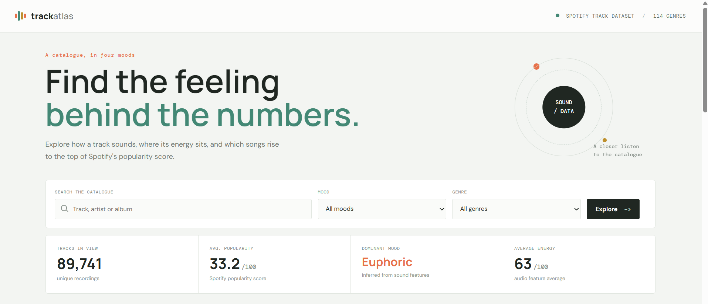

# Spotify Track Atlas – Music Data Analytics Dashboard

## Overview
A web-based music analytics dashboard that analyses Spotify
tracks based on popularity, energy, valence, mood and genre.

## Features
- Mood classification
- Genre-based filtering
- Track search
- Popularity analysis
- Top genre identification
- Statistical dashboard

## Tech Stack
- Node.js
- Express.js
- EJS
- HTML
- CSS
- CSV Parse

## Installation and Setup

1. Clone the repository:
   git clone https://github.com/Anagha0516/spotify-track-atlas.git

2. Navigate to the project folder:
   cd spotify-track-atlas

3. Install dependencies:
   npm install

4. Start the application:
   npm start

5. Open in your browser:
   http://localhost:3000

## Dataset
Uses a Spotify tracks dataset containing audio
features and popularity information.
## Dashboard Preview

### 1. Main Analytics Dashboard

### 2. Mood Classification and Genre Distribution

### 3. Spotify Tracks Ranked by Popularity

## Author
Anagha Pai
